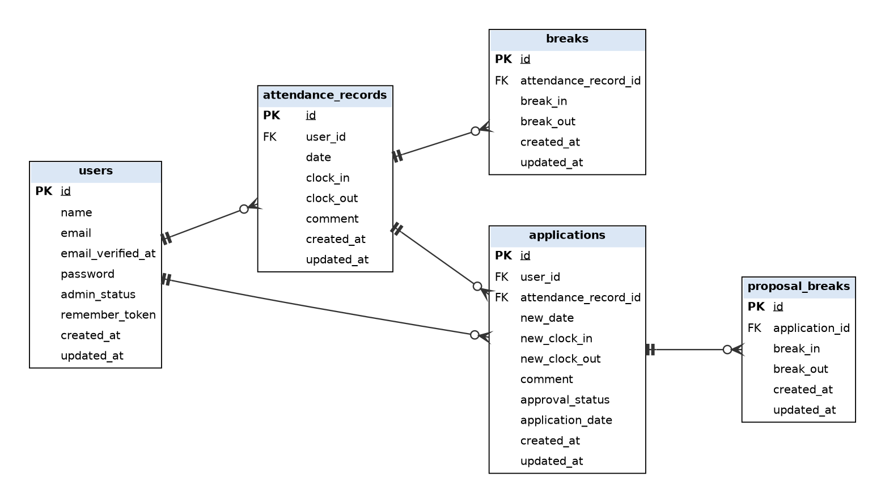

# 勤怠管理アプリ

一般ユーザーが出勤・休憩・退勤を打刻し、勤怠の修正申請を行い、管理者が勤怠の確認・修正・申請の承認を行うアプリケーションです。

## 環境構築

Docker（Laravel Sail）でビルドし、マイグレーションとシーディングまで行います。

### Docker ビルド

1. `git clone https://github.com/hukuitappei/kintai-control.git`
2. `cd kintai-control`
3. `cp .env.example .env`
4. 依存パッケージのインストール（初回のみ。`vendor/` を作るために Docker で実行します）
   ```bash
   docker run --rm -u "$(id -u):$(id -g)" -v "$(pwd):/var/www/html" -w /var/www/html \
     laravelsail/php82-composer:latest composer install --ignore-platform-reqs
   ```
5. `./vendor/bin/sail up -d --build`

※ MySQL がポート 3306 の競合で起動しない場合は、`.env` に `FORWARD_DB_PORT=3307` を追加して、もう一度 `./vendor/bin/sail up -d` を実行してください。

### Laravel 環境構築

1. `./vendor/bin/sail artisan key:generate`
2. `./vendor/bin/sail artisan migrate`
3. `./vendor/bin/sail artisan db:seed`
4. `./vendor/bin/sail npm install`
5. `./vendor/bin/sail npm run dev`（開発中は起動したままにしてください）

## 使用技術（実行環境）

- PHP 8.2
- Laravel 10.x（Fortify / Sanctum）
- MySQL 8.4
- Laravel Sail（Docker）
- Vite

## ER図



## URL

- 開発環境: http://localhost/
- 管理者ログイン: http://localhost/admin/login
- phpMyAdmin: http://localhost:8080/
- Mailpit: http://localhost:8025/（会員登録時のメール認証で使用します）
- マイ勤怠レポート: http://localhost/attendance/report（一般ユーザーでログイン）
- 公開API: http://localhost/api/v1/attendance-records

## 公開API（v1）

| メソッド | エンドポイント | 認証 | 内容 |
|---|---|---|---|
| GET | /api/v1/attendance-records | 不要 | 勤怠一覧（`user_id`・`date`・`month`・`page`・`per_page` で絞り込み、`per_page` は最大100） |
| GET | /api/v1/attendance-records/{attendanceRecord} | 不要 | 勤怠詳細（ユーザー・休憩・修正申請を含む） |
| POST | /api/v1/attendance-records | 必要 | 勤怠登録 |
| PUT/PATCH | /api/v1/attendance-records/{attendanceRecord} | 必要 | 勤怠更新（本人または管理者） |
| DELETE | /api/v1/attendance-records/{attendanceRecord} | 必要 | 勤怠削除（本人または管理者） |

認証が必要なエンドポイントは、Laravel Sanctum のトークンを `Authorization: Bearer <トークン>` ヘッダで送信してください。

## ログイン情報

| 種別 | メールアドレス | パスワード |
|---|---|---|
| 一般ユーザー（user1） | user1@example.com | password |
| 一般ユーザー（user2） | user2@example.com | password |
| 管理者（user3） | user3@example.com | password |

いずれもメール認証済みです。user1 には、マイ勤怠レポートの確認用に過去6ヶ月分の勤怠データ（残業・遅刻・早退・長時間労働を含む）を登録しています。

## テスト

```bash
./vendor/bin/sail artisan test
```

テストはテスト用データベース（`testing`。Sail の MySQL コンテナ初回起動時に自動で作成されます）を使用します。
